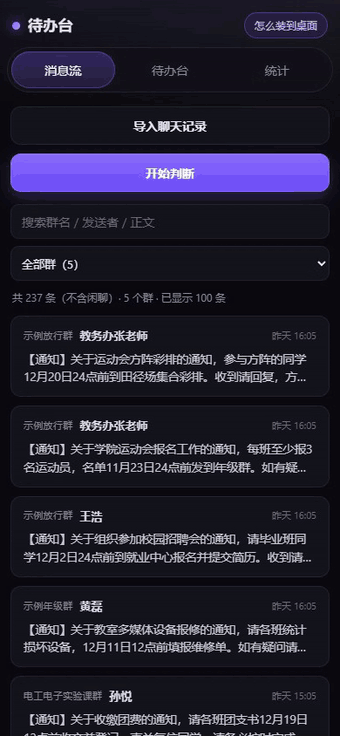
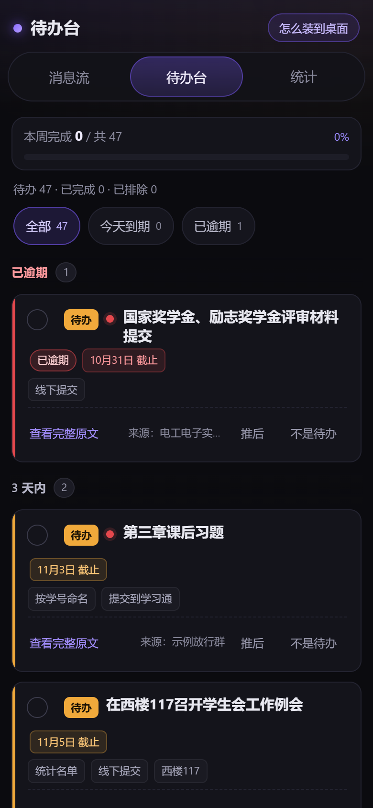
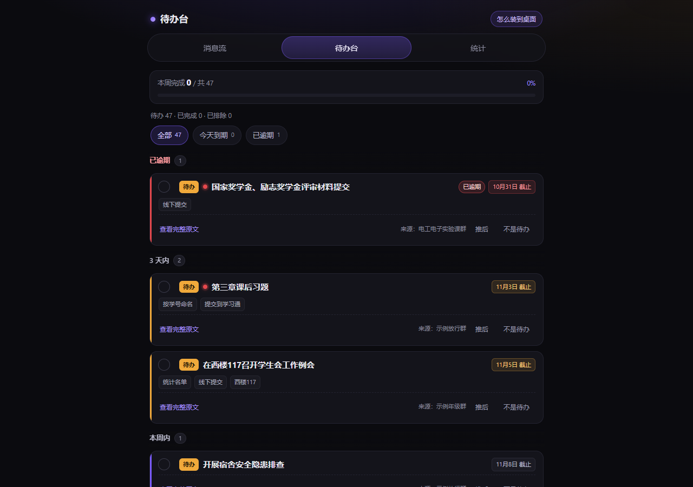
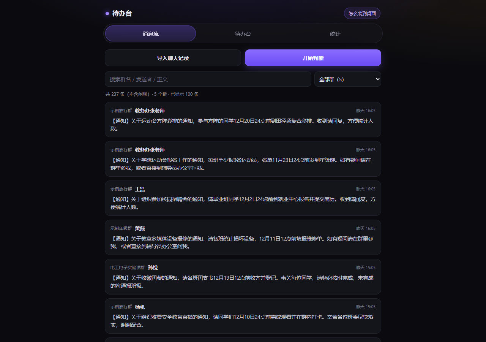
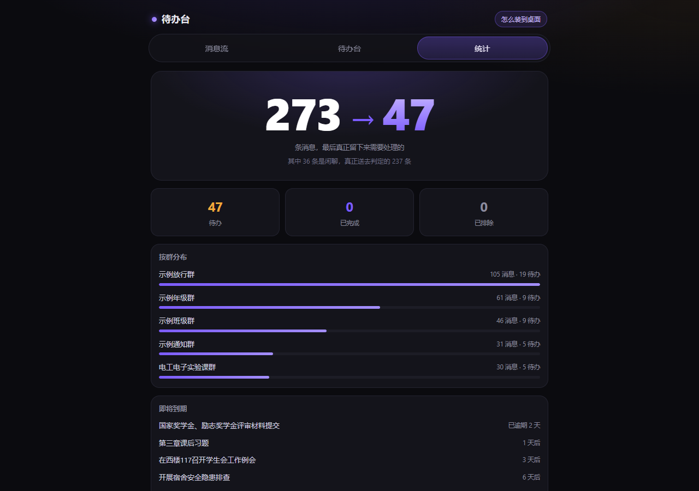

# QQ 待办台 · qq-todo

> **把 QQ 群消息自动变成待办清单的自托管 Web 应用。** 群消息多到刷不过来时，它替你挑出「真正需要你动手」的那几条，抽好截止时间与交付要求，给你一张能勾、能提醒、能离线打开的清单。
>
> **Turn noisy QQ group chats into a clean, mobile-friendly todo list.** It reads exported chat logs *or* subscribes to a live NapCat / OneBot 11 feed (read-only), decides which messages actually need **you**, extracts deadlines and constraints, and gives you a checkbox page that installs as a PWA. Runs offline with a rule-based engine (zero cost, deterministic), or plug in any OpenAI-compatible model. Node 24, no build step, no database, no framework.

<p align="center">
  <a href="https://github.com/xingminggong977-ctrl/qq-todo/actions/workflows/ci.yml"></a>
  <a href="https://github.com/xingminggong977-ctrl/qq-todo/blob/main/LICENSE"></a>
  <a href="https://github.com/xingminggong977-ctrl/qq-todo/blob/main/package.json">= 24" src="https://img.shields.io/badge/node-%E2%89%A5%2024-brightgreen.svg"></a>
  <a href="https://github.com/xingminggong977-ctrl/qq-todo/blob/main/CHANGELOG.md"></a>
</p>

**一句话定位**：把 QQ 群里「谁都要看一眼、但没人记得做」的通知，自动变成一张能勾、能提醒、能离线打开的待办清单——自托管、单进程，数据就是你自己机器上的一个 JSON 文件。

<p align="center"></p>

> **在线演示**：本仓库不自带公共实例，这一行留给你自己部署的地址——上线后访问 `https://<你的域名>/demo/` 即可，**不需要口令**。演示库在首次访问时自动生成（内置 mock 数据），不读也不写你的真实数据，所有写操作一律返回 `405`。本地 `npm start` 后访问 `http://127.0.0.1:7788/demo/` 效果一样（见 `src/server/app.js` 的 `/demo` 分支、`src/server/demo.js`）。

## 目录

- [特性](#特性)
- [效果](#效果)
- [5 分钟快速开始](#5-分钟快速开始)
- [配置项（`.env`）](#配置项env)
- [架构](#架构)
- [判定三分口径](#判定三分口径)
- [常见问题](#常见问题)
- [开发](#开发)
- [API 一览](#api-一览)
- [许可证](#许可证)

把 QQ 群里「谁都要看一眼、但没人记得做」的通知，自动变成一张能勾的待办清单。

群消息一天几百条，真正需要你动手的往往只有三四条：要交的表、要到场的会、要报的名。
本项目把这些捞出来，配上截止日期、约束要点和原文溯源，放进一个手机浏览器打开就能勾的页面里。

## 特性

- **自动拉群消息** — 两种入口：导入 QQ 导出的 `.txt` 聊天记录，或通过 NapCat（OneBot 11）
  **只读**订阅实时消息。实时通道默认关闭，不碰你现有的机器人。
- **判定三分口径** — 每条消息落到 `待办` / `不是待办` / `无法判定` 三档之一，不是一个含糊的分数。
  `无法判定` 单独留档，方便你事后回看规则漏在哪。
- **附件与图片正文解析** — 群文件（PDF / DOCX / TXT）会抓下来抽正文；图片消息走可选的多模态端点
  读图，把「作业要求截图」里的截止日期也读出来。
- **到期提醒走 QQ 与 Web Push** — 服务端定时器可以把当天到期项推到你自己的 QQ 私聊，或通过
  Web Push 推到手机锁屏（需要自己生成一对 VAPID 密钥）。
- **PWA 安装** — 加进主屏后像原生应用一样全屏打开，断网也能看到外壳与已缓存数据。
- **备份与恢复演练** — `deploy/backup.sh` 打包、`deploy/restore-drill.mjs` 真解包真起实例做对账，
  不是「备份了但没验过」。
- **ICS 日历订阅** — `/api/calendar.ics` 输出标准 iCalendar，可以订阅进 iOS/Android 系统日历。
- **零构建、零框架、少依赖** — 前端是 vanilla JS 三视图，后端纯 ESM，数据是一个 JSON 文件。
  运行时依赖只有 4 个：`mammoth`、`pdf-parse`、`qrcode`、`web-push`。

## 效果

<p align="center">
  
  
</p>

<p align="center">
  
  
</p>

> 以上截图与顶部的动图跑的都是仓库自带的演示数据（`npm run seed` 或 `/demo`），群名与内容全部是虚构示例，不含真实账号。

## 5 分钟快速开始

只需要 **Node.js >= 24**（用到内置的全局 `WebSocket`、`fetch`）。

```bash
git clone <你的 fork 地址> qq-todo && cd qq-todo
npm install --omit=dev
cp .env.example .env
```

`.env` 里所有键都有默认值，**不填也能启动**（等价于下面的 stub 模式）。

### 模式 A：`stub` 离线规则引擎（什么都不用配，推荐先跑这个）

```bash
npm run seed     # 造 220 条演示群消息（跳过也行，直接导入自己的记录）
npm run extract  # 判定 + 生成待办
npm start        # 终端会打印「本机」「手机」两个地址 + 二维码
```

浏览器打开打印出来的地址即可。手机和电脑在同一局域网时，扫终端里那个二维码直接就能用。

### 模式 B：接一个 OpenAI 兼容模型

编辑 `.env`：

```dotenv
LLM_PROVIDER=openai
LLM_BASE_URL=https://api.openai.com/v1     # 或任何兼容端点，例如 https://api.deepseek.com/v1
LLM_API_KEY=sk-your-key-here
LLM_MODEL=gpt-4o-mini
```

重启后 `npm run extract` 就走模型判定。注意：**消息正文会被发往你填的这个端点**，
它在你的控制范围内，但请自行评估隐私影响（见 [SECURITY.md](SECURITY.md)）。

### 模式 C：NapCat 实时订阅（只读）

需要先有一个跑起来的 NapCat，且它的 OneBot 11 服务以 **WS server** 模式监听：

```dotenv
LIVE_ENABLED=on
NAPCAT_WS_URL=ws://127.0.0.1:3001/
NAPCAT_ACCESS_TOKEN=你的-onebot-token
GROUP_ALLOWLIST=示例放行群,示例班级群     # 逗号分隔的**群名**；留空=全部收
OWNER_QQ=10001                             # 只有这个号能走私聊通道
```

订阅器是**只读客户端**：只收事件、只调 `get_group_msg_history` 读历史，不会主动发消息
（提醒功能除外，且需要你显式开启）。长期部署见 [deploy/README.md](deploy/README.md)。

### 导入自己的 QQ 记录

QQ 客户端 → 群聊 → 消息记录 → 导出为 `.txt`（两种格式都支持），然后：

```bash
npm run import -- ./我的群聊记录.txt
npm run extract
```

也可以直接在页面上导入（`POST /api/ingest`）。

## 配置项（`.env`）

`.env` 由 `src/config.js` 自己解析（20 行内，不引 dotenv）。**系统环境变量优先于 `.env`**。

| 键 | 默认值 | 必需 | 说明 |
| --- | --- | --- | --- |
| `PORT` | `7788` | 否 | HTTP 监听端口 |
| `HOST` | `0.0.0.0` | 否 | 想只本机用就写 `127.0.0.1`；手机要连就得是 `0.0.0.0` |
| `DATA_DIR` | `./data` | 否 | `store.json` 与附件所在目录，**不要提交进版本库** |
| `PUBLIC_URL` | 空 | 否 | 二维码/链接用的公网地址，如 `https://todo.example.com`；留空自动取局域网 IPv4 |
| `AUTH_TOKEN` | 空 | 生产必需 | **留空 = 不鉴权**。非空时页面与接口都要带 `?t=<token>` 或 `qqtd` Cookie |
| `HTTPS_PORT` | `0` | 否 | 直接对外提供 HTTPS 时填；`0` = 不监听 |
| `TLS_CERT` / `TLS_KEY` | 空 | 否 | 证书与私钥路径，填了才生效 |
| `REDIRECT_PORT` | `0` | 否 | 只做「跳 https」的端口，如 `80`；`0` = 不监听 |
| `DEMO_ENABLED` | `on` | 否 | 是否开放 `/demo` 只读演示：匿名可访问、独立演示库、写操作一律 `405`。设 `off` 可彻底关掉 |
| `LLM_PROVIDER` | `stub` | 否 | `stub` 本地规则 / `openai` 兼容端点 |
| `LLM_BASE_URL` | `https://api.openai.com/v1` | 否 | OpenAI 兼容的 base url |
| `LLM_API_KEY` | 空 | `openai` 模式必需 | 模型密钥，**不要提交** |
| `LLM_MODEL` | `gpt-4o-mini` | 否 | 模型名 |
| `LLM_TIMEOUT_MS` | `90000` | 否 | 单次请求超时 |
| `LLM_PRICE_IN` / `LLM_PRICE_OUT` | `0.14` / `0.28` | 否 | 美元/百万 token，只用于成本估算 |
| `LIVE_ENABLED` | `off` | 否 | `on` 才启动 NapCat 订阅器 |
| `NAPCAT_WS_URL` | `ws://127.0.0.1:3001/` | 否 | OneBot 11 WS 地址 |
| `NAPCAT_ACCESS_TOKEN` | 空 | 否 | OneBot 的 bearer token |
| `GROUP_ALLOWLIST` | 空 | 否 | 逗号分隔的**群名**白名单；留空 = 收全部群 |
| `OWNER_QQ` | 空 | 否 | 允许走私聊转发通道的 QQ 号 |
| `PRIVATE_ALIAS` | 空 | 否 | 私聊在界面上的别名，留空显示 QQ 号 |
| `LIVE_POLL_ENABLED` | `off` | 否 | WS 掉线时的轮询兜底 |
| `LIVE_POLL_INTERVAL_SEC` | `300` | 否 | 轮询间隔（秒） |
| `LIVE_POLL_MAX_PER_GROUP` | `50` | 否 | 每群每次最多拉多少条 |
| `VISION_ENABLED` | `on` | 否 | 图片消息是否走视觉端点 |
| `VISION_MODEL` | `qwen3-vl-plus` | 否 | 视觉模型名（复用 `LLM_BASE_URL` / `LLM_API_KEY`） |
| `VISION_MAX_PER_RUN` | `8` | 否 | 单次抽取最多处理几张图（控成本） |
| `VISION_TIMEOUT_MS` | `30000` | 否 | 视觉请求超时 |
| `VAPID_PUBLIC_KEY` / `VAPID_PRIVATE_KEY` | 空 | Web Push 必需 | `npx web-push generate-vapid-keys` 生成 |
| `VAPID_SUBJECT` | `mailto:admin@example.com` | 否 | VAPID 联络地址 |

## 架构

```
                    ┌──────────────────────────────┐
  QQ 导出 .txt ────▶ │ src/ingest/parser.js          │
                    │ 两种文本格式 → Message[]       │
                    └───────────────┬──────────────┘
                                    │
  NapCat ── WS(只读) ──▶ src/live/napcat.js ──┐
  (OneBot 11)             只收事件/读历史     │
                                    ▼        ▼
                    ┌──────────────────────────────┐
                    │ src/store.js  (data/store.json)│  ← 唯一读写入口
                    │ 消息 / 待办 / 运行记录         │     原子替换写
                    └───────────────┬──────────────┘
                                    ▼
                    ┌──────────────────────────────┐
                    │ src/extract/pipeline.js       │
                    │  ① 噪音过滤  ② 判定三分       │
                    │  ③ 截止日/约束抽取            │
                    │  ④ 附件正文 + 图片视觉        │
                    └───────────────┬──────────────┘
                        ┌───────────┴───────────┐
                        ▼                       ▼
              LLM_PROVIDER=stub        LLM_PROVIDER=openai
              （本地规则，零成本）      （OpenAI 兼容端点）
                                    │
                                    ▼
                    ┌──────────────────────────────┐
                    │ src/server/  (node:http)      │
                    │ 鉴权 → /api/* → public/ 静态  │
                    └───────────────┬──────────────┘
                                    ▼
        浏览器（三视图：消息流 / 待办台 / 统计，PWA 可装到主屏）
                                    │
            ┌───────────────────────┼───────────────────────┐
            ▼                       ▼                       ▼
      Web Push（VAPID）      QQ 私聊提醒（提醒脚本）    ICS 日历订阅
```

### 判定三分口径

| 档位 | 含义 | 去向 |
| --- | --- | --- |
| `待办` | 明确要求「某人某时做某事」 | 进待办台，带截止日与约束 |
| `不是待办` | 闲聊、表情、已完成的回执 | 留在消息流，不进待办台 |
| `无法判定` | 信息不足或规则没覆盖 | 单独留档，用于改进规则 |

「无法判定」不进待办台，但**不丢**——统计页能看到有多少条落在这个桶里，这是刻意留的改进入口。

## 常见问题

| 现象 | 原因与处理 |
| --- | --- |
| 启动报 `EADDRINUSE` | 7788 被占。`ss -lntp \| grep 7788`（Windows：`Get-NetTCPConnection -LocalPort 7788`）查占用者，或改 `.env` 的 `PORT` |
| 手机打不开，电脑能开 | ① `HOST` 是不是 `127.0.0.1`；② 防火墙/安全组没放行 7788；③ 手机和电脑不在同一网段（或直接配 `PUBLIC_URL`） |
| 打开是 401 | 链接没带 `?t=`，或令牌与 `.env` 不一致。用启动时打印的那条手机地址重新打开 |
| 每个请求都 401，但链接带 token | `AUTH_TOKEN` 值里有空格或引号。`.env` 的值不要加行内注释 |
| `/api/live` 一直 `enabled:false` | `LIVE_ENABLED` 不是 `on`；或 NapCat 的 WS 没起（`journalctl` 里有重连日志）。不影响导入与待办 |
| 终端二维码乱码/不显示 | 终端字体不支持块字符。直接把「手机：」那行地址发给手机，不影响使用 |
| 提示「二维码太大，终端放不下」 | `AUTH_TOKEN` 太长。改用地址访问，或把 token 缩短到 32 位以内 |
| `store.json` 读坏 / JSON 解析报错 | 停服务，备份后删除 `data/store.json`，重启会重建空库 |
| `npm run smoke` 失败 | 先看它打出的「期望 / 实际」；多数是 Node < 24 或依赖没装全 |
| 抽取很慢或一直 0 条 | `stub` 是纯本地规则，不会有网络延迟；配了 `openai` 但 `LLM_API_KEY` 为空会全部失败，`errors` 里能看到原因 |
| 改了 `.env` 不生效 | 环境变量优先于 `.env`：`export FOO=` 的空值会被当成未设置，非空值会盖住 `.env` |
| 判定结果不合口味 | 先看统计页的「无法判定」桶，再改 `src/extract/provider.js` 里的规则；改完跑 `npm test` |
| **为什么群消息要转发或拉群？** | 两条路都需要一个「能收到消息的位置」：① 实时通道靠机器人账号在群里，NapCat 只是这台机器上的只读客户端，机器人不在群就收不到；② 不想拉群就用手动转发——私聊发给机器人，`OWNER_QQ` 白名单认你本人的转发（`src/live/napcat.js` 的 `ownerQq` 判定），别人发的进不来；③ 两种都不想碰，就直接导入导出的 `.txt`，判定结果完全一样 |
| **不用 QQ 能不能用？** | 能。输入层本质是「一段文本 → 一条消息」，`npm run import -- <文件>` 或页面上的导入按钮，喂任意符合 `fixtures/qq-export-a-sample.txt` 格式的文本（聊天记录、群公告、甚至手写的清单）都行。实时订阅只是可选的第二个入口 |
| **数据存在哪、会不会上传？** | 全部在 `<DATA_DIR>/store.json`（默认 `./data`，见 `src/store.js` 头注释：进程内串行写 + 原子替换）。只有三种情况会有外发流量，且都由你自己决定：① `LLM_PROVIDER=openai` 时，待判定的消息正文会发到你配的 `LLM_BASE_URL`；② 开启 Web Push 后，通知经浏览器厂商的推送服务中转；③ 实时订阅连的是你自己网络里的 NapCat。用 `stub` 且不开订阅 = 全程离线 |

更多运维问题（备份、恢复演练、日志轮转、systemd）见 [deploy/README.md](deploy/README.md)。

## 开发

```bash
npm start                    # 起服务（node --watch 用 npm run dev）
npm test                     # 全量自测：fixtures/selftests/*.mjs + src/live/_test/test-*.mjs
npm run smoke                # 端到端：起真实服务进程逐条断言
npm run check-secrets        # 泄漏门禁：真实域名/IP/令牌/QQ 号/本机路径一律 fail
```

改之前请读 [CONTRIBUTING.md](CONTRIBUTING.md)。设计契约在 [docs/SPEC.md](docs/SPEC.md)，
上线与验收口径在 [docs/HANDOVER.md](docs/HANDOVER.md)，PWA 安装细节在 [docs/PWA.md](docs/PWA.md)。

### 目录结构

```
src/
  config.js          .env 解析与默认值
  shared/            时间、消息 ID、噪音判断
  store.js           store.json 的唯一读写入口（原子替换）
  ingest/            QQ 导出解析 + 演示数据
  extract/           抽取流水线 + provider（stub / openai）+ 附件 + 视觉
  cli/               import / extract / seed 命令行
  live/              NapCat(OneBot 11) 只读订阅器、附件与图片抓取、轮询兜底
  server/            HTTP 层：index / app / api / http / static / banner / deps / push
public/              前端三视图 + PWA（零构建 vanilla JS）
scripts/             smoke.mjs / test.mjs / check-secrets.mjs / eval-extract.mjs
fixtures/            自测与演示数据（selftests / attachments / eval / QQ 导出样例）
deploy/              systemd unit、备份与恢复演练、提醒脚本
docs/                设计契约、上线说明、PWA 记录
```

## API 一览

所有 `/api/*` 都受 `AUTH_TOKEN` 保护（`AUTH_TOKEN` 为空时不鉴权）。错误统一返回
`{ "error": { "code": "...", "message": "..." } }`，状态码 400 / 401 / 404 / 413 / 500。

| 方法 | 路径 | 说明 |
| --- | --- | --- |
| GET | `/api/health` | 版本、provider、四类计数 |
| GET | `/api/messages` | `limit` / `group` / `noise=exclude` |
| POST | `/api/ingest` | `{filename, content, format?}` 导入 QQ 导出文本 |
| POST | `/api/extract` | `{limit?, force?, group?}` 抽待办，幂等 |
| GET | `/api/todos` | `status` / `limit`，附 `stats` |
| GET | `/api/todos/:id` | 单条待办 + 来源消息 |
| PATCH | `/api/todos/:id` | `{status}` 勾选/恢复/忽略 |
| GET | `/api/stats` | 计数、漏斗、分组、临期待办 |
| GET | `/api/live` | 实时订阅器状态 |
| POST | `/api/seed` | `{count?}` 灌演示数据（演示/自测用） |
| GET | `/api/calendar.ics` | 待办导出为 iCalendar，可被系统日历订阅 |
| GET | `/api/export.csv` | 待办导出为 CSV（带 BOM，Excel 直接打开不乱码） |
| POST | `/api/todos/bulk` | `{ids[], status}` 批量勾选/忽略，单次上限 200 条 |
| GET | `/api/decisions` | 判定日志：每条消息为什么被判成待办或闲聊 |
| GET | `/api/groups` | 群列表与三态（正常 / 安静 / 屏蔽） |
| GET | `/demo/` | 只读演示站，自带虚构数据，改不动 |

## 许可证

[MIT](LICENSE) © QQ-Todo contributors

本项目与腾讯、QQ、NapCat 均无隶属关系。请自行确保你导入或订阅的聊天记录你有权处理。

---

## 仓库与发布

本仓库发布在 `xingminggong977-ctrl/qq-todo`（徽章、issue 模板、`package.json` 的 `repository`/`bugs`/`homepage` 都指向它）。如果你想 fork 成自己的版本，把这些位置一次性换掉：

```bash
grep -rl "xingminggong977-ctrl/qq-todo" --exclude-dir=node_modules --exclude-dir=.git . \
  | xargs sed -i 's|xingminggong977-ctrl/qq-todo|yourname/qq-todo|g'
node scripts/check-secrets.mjs   # 确认替换没顺手带进别的东西
```

Windows 上没有 `sed`，用 PowerShell：

```powershell
Get-ChildItem -Recurse -File -Include *.md,*.yml,*.json |
  Where-Object { $_.FullName -notmatch 'node_modules|\.git' } |
  ForEach-Object { (Get-Content $_.FullName -Raw) -replace 'xingminggong977-ctrl/qq-todo','yourname/qq-todo' | Set-Content -NoNewline $_.FullName }
```

替换完记得再点一遍标题栏徽章，确认它们指向你自己的仓库（CI 徽章在第一次 Actions 跑完后才有内容）。发布会用到的完整步骤见 [docs/RELEASE.md](docs/RELEASE.md)。
